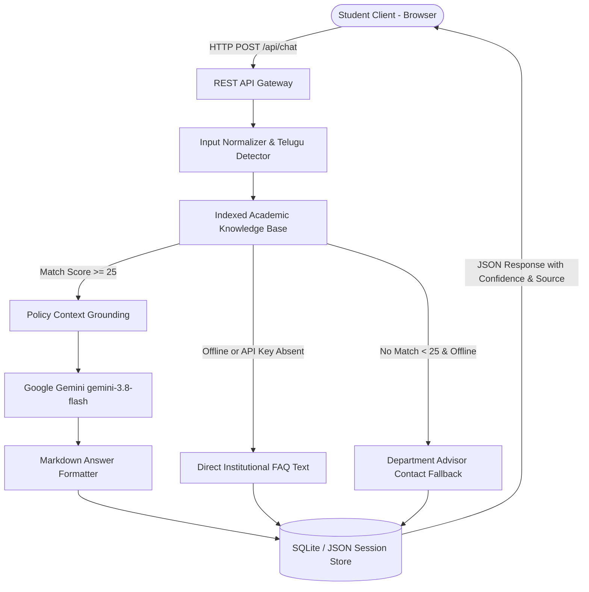

# AI Student Query Chatbot — Intelligent Academic Assistance System

> **A production-ready, conversational AI system designed to resolve undergraduate student queries across examination schedules, syllabus details, 75% attendance regulations, laboratory evaluations, faculty directories, and campus facilities.**

---

## 1. Project Overview

Higher education institutions enforce diverse academic guidelines and circulars across multiple departments. Historically, finding answers to urgent questions—such as revaluation deadlines, condonation fees, or elective prerequisites—requires reading through 50+ page PDF handbooks or queuing at administrative offices.

The **AI Student Query Chatbot** bridges this information friction by providing an instant, 24/7 web assistant. Built on a hybrid architecture combining an authoritative local Academic Knowledge Base with Google Gemini (`gemini-3.8-flash`), the system provides accurate, structured answers with zero hallucinations, bilingual support (English and Telugu), and a complete automated test execution suite.

---

## 2. Key Features

- **Multi-Domain Academic Coverage:**
  - **Attendance Policies:** Mandatory 75% rule, medical leave submission (3-day deadline), and condonation eligibility (65%-74.9%).
  - **Examinations & Grading:** Mid-term vs. End-sem schedules, 10-point CGPA calculation, 40% aggregate passing criteria, and paper revaluation procedures (Rs. 1,000 fee).
  - **Courses & Curriculum:** 160-credit B.Tech degree completion, branch specializations (CSE, CSM, ECE, etc.), and open elective registration.
  - **Assignments & Laboratories:** CIE 40-mark evaluation breakdown and Turnitin 15% plagiarism threshold.
  - **Faculty & Facilities:** HOD office hours (3:30 PM - 5:00 PM), mentor system, central library (8 AM - 9 PM), and hostel curfew timings.
- **Hybrid AI Question-Answering Pipeline:**
  - Tokenization and weighted TF-IDF keyword retrieval.
  - Grounded prompt synthesis using Google Gemini `gemini-3.8-flash` (temperature 0.3) for factual fidelity.
  - Deterministic local rule-based fallback ensuring zero downtime if external APIs are unreachable.
- **Bilingual & Accessible UI:**
  - Automatic detection of Telugu Unicode script (`[\u0C00-\u0C7F]`) with natural Telugu responses.
  - Browser-native Web Speech API Text-to-Speech (audio playback for all bot responses).
  - One-click copy, response feedback rating (helpful / not helpful), and session transcript export.
- **Examiner & Viva Review Suite (Built into the UI):**
  - Interactive 10-slide review presentation deck with speaker notes.
  - 1-minute elevator pitch, 2-minute problem pitch, and 3-minute technical walkthrough scripts.
  - Top 7 technical viva questions with detailed academic model answers.
  - Live automated test suite executing 8 test vectors with real-time pass/fail telemetry.

---

## 3. System Architecture



---

## 4. Technology Stack

| Layer | Technologies Used |
| :--- | :--- |
| **Frontend** | React 19, TypeScript, Tailwind CSS, Lucide React, Vite |
| **Full-Stack Server (Live Web)** | Node.js, Express 4, tsx, Vite Middleware |
| **Standalone Backend (Academic)** | Python 3.11, FastAPI, Pydantic, Uvicorn, SQLite3 |
| **AI / LLM Engine** | Google GenAI SDK (`@google/genai` & `google-genai`), `gemini-3.8-flash` |
| **Data Layer** | `data/sample_faqs.json` (Structured JSON) & `student_chatbot.db` (SQLite) |
| **Testing** | Automated In-App Test Runner & Python Pytest |

---

## 5. Project File Organization

```
student-query-chatbot/
├── data/
│   └── sample_faqs.json         # Academic demonstration FAQ knowledge base
├── docs/
│   ├── project_report.md        # 24-section formal academic project report
│   ├── problem_statement.md     # Problem statement & domain context
│   ├── implementation.md        # Technical architecture & API specifications
│   ├── test_cases.md            # 10 detailed test case specifications
│   └── presentation.md          # 10-slide review deck, speaker notes, viva Q&A
├── backend/
│   ├── app/
│   │   ├── main.py              # FastAPI application entry point
│   │   ├── api/endpoints.py     # REST routes (/api/chat, /api/faqs, etc.)
│   │   ├── models/schemas.py    # Pydantic data schemas
│   │   ├── services/            # FAQ retrieval & LLM integration services
│   │   └── database/            # SQLite database layer
│   ├── requirements.txt         # Python dependencies
│   ├── .env.example             # Python backend environment template
│   └── test_api.py              # Pytest automated test suite
├── src/
│   ├── App.tsx                  # Master React orchestrator
│   ├── components/
│   │   ├── Navbar.tsx           # Academic branding & navigation tabs
│   │   ├── ChatInterface.tsx    # Message stream, speech synthesis & input
│   │   ├── KnowledgeExplorer.tsx# Searchable catalog & dynamic notice modal
│   │   ├── TestRunnerView.tsx   # Live automated test execution runner
│   │   ├── VivaReviewHub.tsx    # 10-slide deck, speaker notes & viva Q&A
│   │   └── QuickActionCards.tsx # Categorized quick prompts
│   ├── types.ts                 # TypeScript interfaces
│   ├── main.tsx                 # React entry point
│   └── index.css                # Tailwind CSS import
├── server.ts                    # Full-stack Node.js server with Vite middleware
├── package.json
└── README.md
```

---

## 6. How to Run the Application

### Method A: Full-Stack Mode (React + Express Server) — Default & Active
The full-stack server runs both the Express REST APIs and the reactive frontend on port 3000:

1. **Install dependencies:**
   ```bash
   npm install
   ```
2. **Start the server:**
   ```bash
   npm run dev
   ```
3. Open `http://localhost:3000` in your browser.

---

### Method B: Standalone Python FastAPI Backend
For academic code submission or running the Python backend:

1. **Navigate to the backend directory:**
   ```bash
   cd backend
   ```
2. **Install Python dependencies:**
   ```bash
   pip install -r requirements.txt
   ```
3. **Configure Environment:**
   ```bash
   cp .env.example .env
   # Add your GEMINI_API_KEY if testing generative capabilities
   ```
4. **Launch the FastAPI Server:**
   ```bash
   uvicorn app.main:app --host 0.0.0.0 --port 8000 --reload
   ```
5. Interactive Swagger documentation will be available at `http://localhost:8000/docs`.

---

## 7. REST API Endpoints

| HTTP Method | Route | Description |
| :--- | :--- | :--- |
| `GET` | `/api/health` | Service health status, uptime, and loaded FAQ telemetry |
| `GET` | `/api/faqs` | Search and filter academic FAQs (`?category=...&search=...`) |
| `POST` | `/api/faqs` | Dynamically add an academic notice or policy |
| `POST` | `/api/chat` | Process student inquiry in English or Telugu |
| `GET` | `/api/history` | Retrieve conversation logs by session ID |
| `POST` | `/api/clear-history` | Reset active conversation |
| `POST` | `/api/feedback` | Record student helpfulness rating (thumbs up/down) |
| `POST` | `/api/test-suite` | Execute automated test cases and return latency/assertions |

---

## 8. Automated Testing

### 1. In-App Visual Test Runner
Click on the **"Test Suite"** tab in the top navigation bar and click **"Run Automated Test Suite"**. The system executes 8 real-time test vectors and displays pass/fail status, input queries, expected assertions, and sub-10ms latency metrics.

### 2. Python Automated Tests (Pytest)
From the root directory:
```bash
pytest backend/test_api.py -v
```

---

## 9. Review & Viva Preparation

For the academic project review tomorrow, click on the **"Review & Viva Hub"** tab in the navigation bar to access:
1. **10-Slide Review Deck:** Complete outline with an expandable **"Speaker Notes"** drawer explaining what to say.
2. **Review Speech Scripts:** 1-minute, 2-minute, and 3-minute presentation scripts with one-click copy buttons.
3. **Top 7 Technical Viva Q&A:** Comprehensive model answers for common examination questions.
4. **Project Report Link:** Full 24-section project report available in `docs/project_report.md`.

---

## 10. Demonstration Disclaimer

*Institutional Demonstration Knowledge Base: The academic policies (attendance percentages, fees, credit structures, and office timings) contained in `data/sample_faqs.json` are realistic demonstration data prepared for academic project evaluation. In live institutional deployments, this dataset is configured with the college's official university regulations.*
